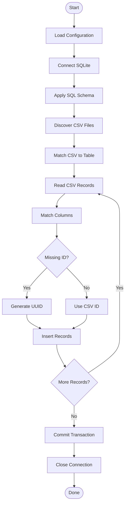

# Database Generator

## 1. Overview

`generate.py` initializes an SQLite database using an INI configuration, SQL schema, and CSV files.

**Features:**
- Automatic configuration generation.
- SQLite database initialization.
- SQL schema execution.
- CSV-to-table importing.
- Automatic UUID generation.
- Transaction management and error handling.

## 2. Configuration

The `config.ini` file controls database and CSV settings.

```ini
[database]
path = template.sqlite
schema = template.sql
foreign_keys = true
timeout = 30

[csv]
directory = data
enabled = true
encoding = utf-8-sig
delimiter = ,
```

## 3. Initialization

The initialization process:

1. Generate `config.ini` if missing.
2. Load configuration.
3. Connect to SQLite.
4. Apply the SQL schema.
5. Discover CSV files.
6. Import CSV records.
7. Commit the transaction.
8. Close the connection.

## 4. CSV Import

CSV filenames must match SQLite table names.

Example: `manga.csv` imports into the `manga` table.

The importer:
- Reads CSV headers and rows.
- Matches CSV columns with SQLite columns.
- Ignores unmatched columns.
- Converts empty values to SQL `NULL`.
- Uses parameterized SQL statements.
- Reports failed rows.

## 5. Execution Flow



## 6. Usage

Run from the project root:

```bash
python database/generate.py
```

**Result:** An initialized SQLite database populated with CSV records and automatically generated UUIDs.